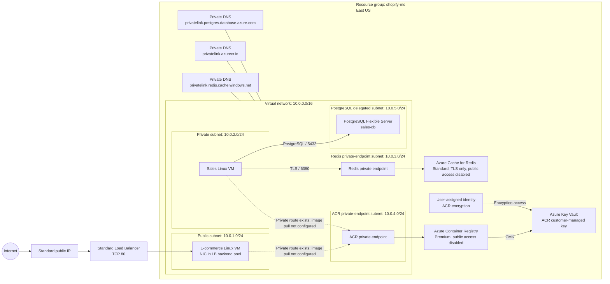

# cloud-iac

## Azure architecture

a general architectural view

### Notes

- The public IP fronts the load balancer; the web VM NIC has no direct public IP.
- PostgreSQL uses its delegated subnet and private DNS. The app subnet remains
  separate so the sales VM is not placed in a PostgreSQL-only delegated subnet.
- Redis and ACR are private-only and have private endpoints plus VNet-linked
  private DNS zones.
- Set globally unique `acr_registry_name` and `acr_key_vault_name` values, and
  provide `postgres_administrator_password` securely when planning/applying.
